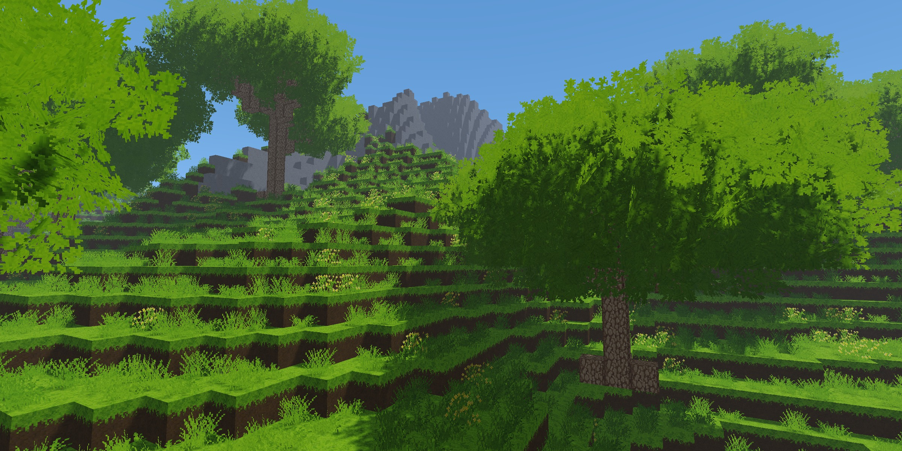

# Voxel Rasterizer

My third voxel engine, and the first one to use rasterization instead of raytracing directly through raw voxel data.

## Expected System Requirements

### Minimum Requirements
*Target: 1080p, 30 FPS, 64–96 block render distance*

| Component | Requirement |
|---|---|
| **GPU** | NVIDIA GTX 1050 2GB / AMD RX 460 |
| **VRAM** | 1GB recommended |
| **CPU** | AMD Ryzen 1000 series / Intel 6th–7th Gen |
| **RAM** | 8GB |
| **OS** | Windows 10 / 11 (Linux via Wine) |

### Recommended Requirements
*Target: 1080p, 60 FPS, 96 block render distance*

| Component | Requirement |
|---|---|
| **GPU** | NVIDIA GTX 1060 3GB / AMD RX 480 |
| **VRAM** | 2GB recommended |
| **CPU** | AMD Ryzen 3000 series / Intel 9th Gen |
| **RAM** | 8GB |
| **OS** | Windows 10 / 11 (Linux via Wine) |